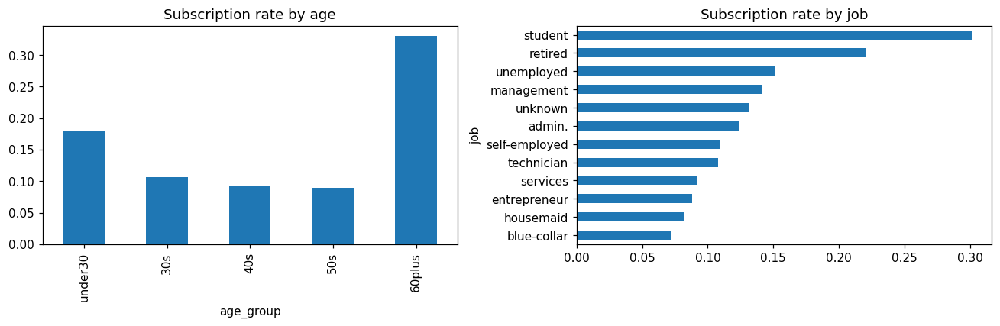
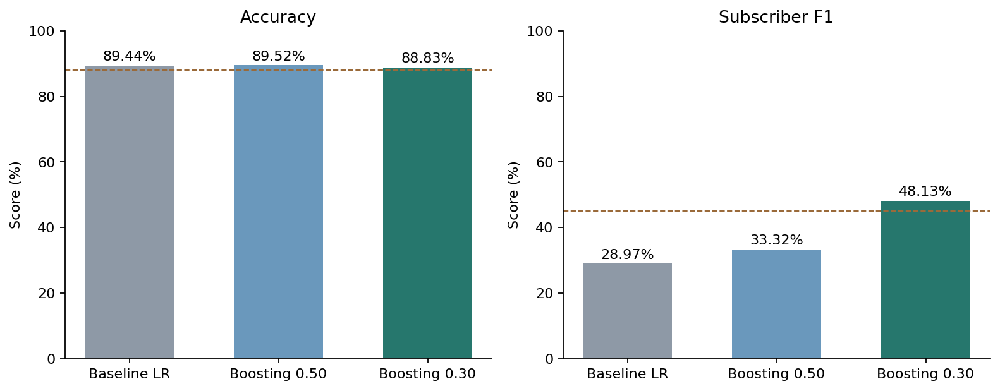

# Bank Marketing Classification

## 정기 예금 가입 예측

가입자가 약 11.7%인 은행 마케팅 데이터에서 고객의 정기 예금 가입 여부를 예측한 개인 프로젝트다. 정확도만 높게 나오는 불균형 데이터의 특성을 확인하고, EDA, 피처 엔지니어링, 모델 비교, 클래스 가중치와 분류 임계값 조정으로 가입자 예측 성능을 개선했다.

**최종 검증 결과: Accuracy 88.83%, 가입자 F1 48.13%, 비가입자 F1 93.74%**

기초 로지스틱 회귀와 비교하면 Accuracy는 0.61%p 낮아졌고 가입자 F1은 19.17%p 높아졌다. 전체 정확도 88% 이상을 유지하면서 소수 집단인 가입자를 더 잘 찾는 것을 목표로 했다.

Python 분류 모델링 학습 프로젝트로, 코드잇 스프린트 미션 12의 데이터와 기초 로지스틱 회귀 설정을 출발점으로 사용했다.

## 1. 분석 문제와 평가 기준

비가입자가 약 88.3%이므로 모든 고객을 비가입자로 예측해도 높은 정확도를 얻는다. 따라서 전체 Accuracy와 함께 가입자 및 비가입자의 F1을 확인했다.

| 구분 | 기준 |
|---|---|
| 예측 문제 | 고객의 정기 예금 가입 여부를 예측하는 이진 분류 |
| 정답 | 비가입 0, 가입 1 |
| 기본 목표 | Accuracy 80% 이상, 가입자 F1 40% 이상 |
| 심화 목표 | Accuracy 88% 이상, 가입자 F1 45% 이상 |
| 주요 비교 기준 | 일정 수준의 Accuracy를 유지하면서 가입자 F1 개선 |

## 2. 데이터

| 항목 | 내용 |
|---|---|
| 제공 자료 | 코드잇 스프린트 미션 12의 `bank_marketing.csv` |
| 전체 크기 | 45,211행, 16열 |
| 가입자 | 5,289명, 11.70% |
| 비가입자 | 39,922명, 88.30% |
| 입력 | 고객 특성, 금융 상태, 연락 정보와 이력 등 15개 열 |
| 실제 결측값 | 0개. `unknown`은 미상 범주로 유지 |
| 완전히 같은 행 | 16행. 고객 ID로 중복 인물을 확인할 수 없어 원본 행 유지 |

입력 변수는 다음 세 묶음으로 구분했다.

| 묶음 | 변수 |
|---|---|
| 고객 특성 | `age`, `job`, `marital`, `education` |
| 금융 상태 | `default`, `balance`, `housing`, `loan` |
| 연락 정보와 이력 | `contact`, `day`, `month`, `campaign`, `pdays`, `previous`, `poutcome` |

원본 CSV는 저장소에 포함하지 않는다. 실행할 때 `data/bank_marketing.csv`에 제공된 파일을 넣는다. 원본 파일 식별용 SHA-256은 `results/environment.json`에 기록했다.

## 3. 분석 설계

제공된 베이스라인과 같은 `test_size=0.3`, `random_state=42`, `stratify=y`를 사용했다. 피처 변환 후에도 기존 행 인덱스를 사용해 같은 고객 배정을 유지했다.

| 구간 | 인원 | 역할 |
|---|---:|---|
| 전체 학습 데이터 | 31,647 | EDA와 최종 모델의 학습 입력 |
| 내부 학습 데이터 | 23,735 | 후보 모델 학습 |
| 내부 조정용 데이터 | 7,912 | 모델 설정과 임계값 선택 |
| 원래 검증 데이터 | 13,564 | 베이스라인과 최종 모델 평가 |

전체 70% 학습 데이터를 다시 75:25로 나누어 내부 비교를 진행했다. 선택한 모델은 전체 학습 데이터로 다시 `fit()`하고, 내부 비교에서 선택한 임계값을 고정해 원래 검증 데이터에 적용했다. 부스팅의 기본 조기 종료 기능은 학습 입력 내부의 일부 표본을 사용한다.

아래 내부 조정용 점수와 최종 검증 점수는 서로 다른 고객에서 구한 결과다. 예비 탐색 중 원래 검증 점수도 여러 차례 확인했으므로, 이 검증 성능을 완전히 미사용인 테스트 성능으로 해석하지 않는다.

## 4. EDA에서 확인한 가입 패턴

EDA는 전체 학습 데이터 31,647명에서 진행했다. 가입 여부를 0과 1로 바꾸어 집단별 평균으로 가입률을 구하고, 집단별 고객 수도 함께 확인했다.

| 관찰한 패턴 | 학습 데이터 가입률 | 반영 방향 |
|---|---|---|
| 연령대 차이 | 60세 이상 32.99%, 30대 10.58% | 나이 구간 추가 |
| 직업별 차이 | 학생 30.13%, 은퇴자 22.08%, 현장 근로자 7.15% | 기존 직업 범주 유지 |
| 대출 여부 차이 | 주택 대출 없음 16.62%, 있음 7.78% | 기존 대출 변수 유지 |
| 이전 캠페인 결과 | 성공 63.75%, 미상 9.26% | `poutcome` 유지 |
| 이전 연락 경험 | 있음 22.74%, 없음 9.25% | 이전 연락 여부 추가 |
| 이번 연락 횟수 | 1회 14.54%, 2~3회 11.28%, 4회 이상 7.29% | 연락 횟수 구간 추가 |



이 차이는 집단 간 관련성을 보여준다. 반복 연락이 가입률 하락의 원인이라고 단정하지 않는다. 가입하지 않은 고객에게 연락이 반복됐을 가능성도 있다. 월별 차이 역시 표본 규모와 고객 구성을 함께 고려했다.

## 5. 피처 엔지니어링

| 처리 | 내용 | 이유 |
|---|---|---|
| `age_group` 추가 | 30세 미만, 30대, 40대, 50대, 60세 이상 | 연령 구간별 가입률 차이 표현 |
| `prev_contacted` 추가 | 과거 연락 경험 1, 없음 0 | `pdays=-1`의 특별한 의미 구분 |
| `days_after_contact`로 대체 | 기존 `pdays`의 -1을 0으로 바꾸고 원래 열 제거 | 연락 여부와 경과 일수를 두 변수로 분리 |
| `campaign_group` 추가 | 1회, 2~3회, 4회 이상 | 연락 횟수별 차이 표현 |
| `balance_log`로 대체 | `sign(balance) * log1p(abs(balance))` | 음수 부호를 유지하며 큰 잔고의 크기 축소 |
| 범주형 원핫 인코딩 | `pd.get_dummies(drop_first=True)` | 모델이 사용할 숫자 입력 생성 |

기존 `age`, `campaign`은 남겨 세부 숫자 정보를 유지했다. 기존 직업, 대출 여부, 이전 캠페인 결과는 이미 범주형 입력에 포함되므로 같은 의미의 변수를 추가로 만들지 않았다.

여러 변환을 함께 적용했으므로 각 피처의 독립적인 효과를 분리한 실험은 아니다. 특히 나무 모델은 값의 순서를 이용하므로, 잔고의 단조 로그 변환이 최종 개선의 주된 원인이라고 해석하지 않는다.

## 6. 모델 개선 과정

### 6-1. 같은 모델에서 피처 변환 전후 비교

같은 고객을 사용한 내부 조정용 비교에서 로지스틱 회귀의 가입자 F1은 27.25%에서 28.95%로 소폭 높아졌다. 피처 변환만으로는 목표에 도달하지 못해 다른 모델과 설정을 비교했다.

### 6-2. 알고리즘과 가중치 비교

다음은 내부 조정용 데이터 7,912명에서 기본 임계값 0.5로 평가한 결과다.

| 모델 | Accuracy | 비가입자 F1 | 가입자 F1 |
|---|---:|---:|---:|
| 로지스틱 회귀, 가공 전 | 89.07% | 94.09% | 27.25% |
| 로지스틱 회귀, 가공 후 | 89.21% | 94.16% | 28.95% |
| 의사결정나무, 깊이 3 | 89.23% | 94.18% | 27.67% |
| 의사결정나무, 깊이 5 | 89.21% | 94.17% | 26.63% |
| 의사결정나무, 깊이 8 | 88.95% | 93.99% | 31.61% |
| 랜덤 포레스트 | 89.21% | 94.13% | 33.39% |
| 랜덤 포레스트, 가입자 가중치 2 | 89.00% | 93.95% | 40.00% |
| 히스토그램 부스팅 | 89.17% | 94.11% | 33.10% |

로지스틱 회귀에는 `StandardScaler`를 적용했다. 의사결정나무는 `max_depth=3, 5, 8`을 비교하고, 랜덤 포레스트에서는 가입자 가중치를 별도로 시험했다. 최종 부스팅에는 클래스 가중치를 추가하지 않았다.

### 6-3. 예측 확률과 임계값 조정

로지스틱 회귀, 랜덤 포레스트, 가중치 랜덤 포레스트, 히스토그램 부스팅에서 임계값 `0.20, 0.225, 0.25, 0.275, 0.30, 0.35, 0.40, 0.50`을 비교했다.

내부 조정용 Accuracy가 88% 이상인 조합을 남기고, 가입자 F1이 가장 높은 조합을 선택했다.

| 선택된 조합 | 내부 조정용 Accuracy | 내부 조정용 가입자 F1 |
|---|---:|---:|
| 히스토그램 부스팅, 임계값 0.30 | 88.06% | 44.96% |

기준을 낮춰 더 많은 고객을 가입자로 분류하되, 전체 정확도가 지나치게 낮아지지 않도록 조건을 적용했다. 정확도 조건을 만족하는 후보가 없으면 오류 메시지를 내도록 했다.

최종 부스팅 설정은 `max_iter=200`, `max_leaf_nodes=31`, `learning_rate=0.1`, `l2_regularization=1`, `random_state=42`다. `max_iter`는 최대 반복 횟수이며, 현재 실행에서는 조기 종료로 41회에서 멈췄다.

## 7. 최종 검증 결과

다음은 동일한 원래 검증 데이터 13,564명에서 평가한 결과다.

| 모델 | Accuracy | 비가입자 F1 | 가입자 F1 |
|---|---:|---:|---:|
| 기초 로지스틱 회귀 | 89.44% | 94.30% | 28.97% |
| 최종 부스팅, 임계값 0.50 | 89.52% | 94.32% | 33.32% |
| **최종 부스팅, 임계값 0.30** | **88.83%** | **93.74%** | **48.13%** |



피처와 알고리즘 변경에 더해 임계값 조정이 가입자 F1 개선에 큰 역할을 했다. 기초 모델 대비 정확도는 0.61%p 낮아졌고, 가입자 F1은 19.17%p 높아졌다. 차이는 반올림 전 점수로 계산했다.

### 혼동행렬

| 실제 / 예측 | 비가입 예측 | 가입 예측 |
|---|---:|---:|
| 실제 비가입자 | 11,346 | 631 |
| 실제 가입자 | 884 | 703 |

실제 가입자 1,587명 중 703명을 찾았다. 가입자로 예측한 1,334명 중 실제 가입자는 703명이다.

- 가입자 정밀도: 52.70%
- 가입자 재현율: 44.30%
- 가입자 F1: 48.13%

F1을 실제 가입자를 찾아낸 비율과 혼동하지 않았다. 실제 가입자를 찾아낸 비율은 재현율이다.

## 8. 최종 모델 선택 이유

1. 내부 조정용 비교에서 Accuracy 88%를 만족한 후보 중 가입자 F1이 가장 높았다.
2. 원래 검증 데이터에서도 Accuracy 88%, 가입자 F1 45%라는 심화 목표를 충족했다.
3. 기본 임계값과 조정 임계값을 같은 모델에서 비교해 판정 기준 변경의 효과를 확인했다.
4. 최종 학습에는 `clone()`으로 같은 설정의 새 모델을 만들어 조정용 모델이 덮어쓰이지 않도록 했다.

## 9. 한계와 다음 개선 방향

- 한 번의 분할로 비교한 결과이며, 조정용 데이터를 반복 사용한 선택 편향이 있다. 예비 실험에서 원래 검증 점수도 여러 번 확인했으므로 완전히 독립된 테스트 성능은 아니다.
- EDA는 전체 학습 데이터에서 진행했으므로 내부 조정용 데이터의 정답도 피처 설계에 일부 반영된다. 이후에는 피처 설계와 설정 선택까지 포함한 검증 절차를 더 엄격히 구성할 수 있다.
- 원핫 열 목록은 제공된 베이스라인처럼 전체 데이터에서 정했다. 현재 데이터에는 원래 검증에만 존재하는 범주가 없었지만, 향후에는 학습 데이터에서 인코딩 기준을 정하는 전처리 파이프라인으로 바꿀 수 있다.
- `campaign`, 마지막 연락 월과 일자는 캠페인이 진행된 후 알게 되는 정보일 수 있다. 캠페인 시작 전 고객 선별에 적용하려면 예측 시점에 사용할 수 있는 변수만 선택해 다시 평가해야 한다.
- 집단별 가입률 차이는 인과 효과가 아니다. 특정 고객에게 연락하면 같은 가입률이 발생한다고 단정하지 않는다.
- 임계값 0.30은 이번 F1 목표를 위한 선택이다. 실제 운영에서는 연락 가능 인원, 연락 비용, 가입 이익을 함께 고려해야 한다.
- 다음 단계에서는 교차검증, 피처별 추가 및 제거 비교, 새로운 기간 데이터 평가를 검토한다.

## 10. 파일 구성

| 경로 | 내용 |
|---|---|
| `bank_marketing.ipynb` | 실행 결과가 포함된 전체 분석 노트북 |
| `requirements.txt` | 분석 패키지 버전과 JupyterLab 설치 범위 |
| `data/README.md` | 원본 데이터 배치 방법 |
| `results/model_comparison.csv` | 원래 검증 데이터의 최종 비교표 |
| `results/tuning_results.csv` | 내부 조정용 기본 임계값 비교표 |
| `results/threshold_search.csv` | 내부 조정용 모델 4종과 임계값 8개의 점수 |
| `results/confusion_matrix.csv` | 최종 혼동행렬 |
| `results/metrics.json` | 최종 모델, 임계값, 점수, 반복 횟수 |
| `results/environment.json` | 재실행 환경과 원본 데이터 식별 해시 |
| `figures/` | README에 사용하는 EDA 및 성능 그래프 |

## 11. 실행 방법

Python 3.12에서 분석 코드를 실행해 결과를 확인했다. 저장소 루트에서 필요한 패키지를 설치한다.

```bash
python -m venv .venv
```

가상환경을 활성화한다.

```bash
# macOS / Linux
source .venv/bin/activate
```

```powershell
# Windows PowerShell
.venv\Scripts\Activate.ps1
```

```bash
python -m pip install -r requirements.txt
python -m jupyterlab
```

1. 제공된 원본 파일을 `data/bank_marketing.csv`에 둔다.
2. `bank_marketing.ipynb`를 연다.
3. 노트북의 모든 셀을 위에서부터 실행한다.
4. 마지막 셀에서 `results/`의 결과표와 성능 그래프가 갱신된다.

GitHub에서는 이미 저장된 노트북 출력과 README의 그림을 바로 확인할 수 있다. 직접 실행하려면 원본 CSV를 별도로 준비해야 한다.
